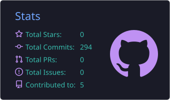
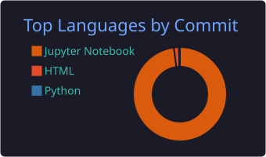
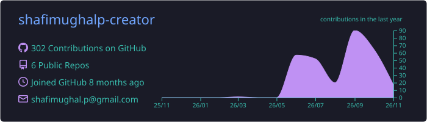
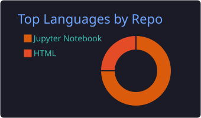

<h1 align="center">Hi 👋, I'm Shafi Mughal</h1>
<h3 align="center">Exploring Data Science, AI & Machine Learning from Pakistan 🇵🇰</h3>

  
  

---

## 👨‍💻 About Me

- 🔭 Currently working on: [Premier League Match Outcome Prediction](https://github.com/shafimughalp-creator/epl-match-outcome-predictor)
- 🌱 Currently learning: **Machine Learning, EDA, and freelancing**
- 👯 Open to collaborate on: [Olist Delivery Performance](https://github.com/shafimughalp-creator/olist-delivery-performance)
- 💬 Ask me about: **Python, EDA, and coding**
- ⚡ Fun fact: **I love finding patterns hidden in data** 🔍

---

## 🛠️ Languages & Tools

  
  
  
  
  
  
  
  

---

## 📌 Featured Projects

| Project | What it does |
|---|---|
| [⚽ EPL Match Outcome Predictor](https://github.com/shafimughalp-creator/epl-match-outcome-predictor) | Predicts Premier League match results using machine learning |
| [📦 Olist Delivery Performance](https://github.com/shafimughalp-creator/olist-delivery-performance) | EDA on Olist e-commerce delivery data |

---

## 📊 GitHub Stats

  
  

  
  

---

## 📈 Contribution Graph

  

---

## 🤝 Connect With Me

  
  
  
  

